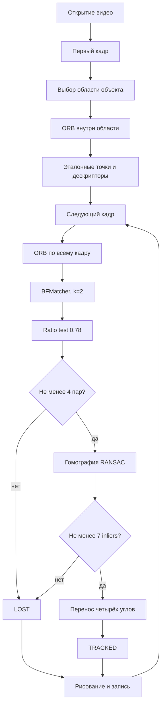

# Лабораторная работа №2

## Трекинг объекта на видео на основе ключевых точек

### Цель работы

Реализовать простейший алгоритм отслеживания объекта на видео с использованием ключевых точек. На первом кадре пользователь задаёт положение объекта, после чего программа должна находить этот объект на следующих кадрах и рисовать вокруг него подписанную рамку, максимально соответствующую его текущему положению и границам.

Работа выполнена на языке **Python 3** с использованием библиотек **OpenCV** и **NumPy**.


## Содержание

1. [Теоретическая база](#1-теоретическая-база)
2. [Описание разработанной системы](#2-описание-разработанной-системы)
3. [Результаты работы и тестирования системы](#3-результаты-работы-и-тестирования-системы)
4. [Выводы по работе](#4-выводы-по-работе)
5. [Использованные источники](#5-использованные-источники)
6. [Установка и запуск](#6-установка-и-запуск)
7. [Структура репозитория](#7-структура-репозитория)

---

# 1. Теоретическая база

## 1.1. Задача трекинга объекта

Трекинг объекта — это определение положения выбранного объекта в последовательности видеокадров.

В данной работе считается, что:

- объект хорошо виден на первом кадре;
- пользователь один раз задаёт его начальную рамку;
- объект преимущественно плоский;
- на поверхности объекта присутствует достаточно текста, углов и других деталей;
- во время движения возможны перенос, поворот, изменение масштаба, умеренное перспективное искажение и частичное перекрытие.

Результатом обработки каждого кадра является четырёхугольная рамка объекта и подпись состояния:

- `TRACKED` — положение объекта определено надёжно;
- `LOST` — достоверных соответствий недостаточно.

Ключевые точки особенно хорошо подходят для книг, коробок, упаковок, обложек и других текстурных объектов. Для однотонных, прозрачных, бликующих или сильно деформируемых объектов этот подход менее устойчив.

## 1.2. Ключевые точки и дескрипторы

**Ключевая точка** — локальная область изображения, которую можно повторно обнаружить после изменения положения объекта.

Обычно ключевыми точками являются:

- углы;
- пересечения линий;
- границы символов;
- небольшие контрастные фрагменты текстуры.

Самих координат точки недостаточно для сопоставления кадров. Поэтому для каждой точки вычисляется **дескриптор** — компактное численное описание её окрестности.

Если две точки принадлежат одной части объекта, их дескрипторы должны быть похожи.

В работе применяется алгоритм **ORB — Oriented FAST and Rotated BRIEF**. Он объединяет:

1. детектор FAST для поиска углов;
2. пирамиду изображений для работы с разными масштабами;
3. оценку ориентации ключевой точки для устойчивости к повороту;
4. модифицированный BRIEF для построения бинарного дескриптора.

ORB формирует дескриптор длиной 256 бит.

Преимущества ORB:

- высокая скорость;
- устойчивость к умеренному повороту;
- устойчивость к изменению масштаба;
- бинарное представление дескриптора;
- наличие в стандартной поставке OpenCV;
- отсутствие необходимости использовать заранее обученную модель.

## 1.3. Расстояние Хэмминга

Бинарные дескрипторы ORB сравниваются с помощью расстояния Хэмминга.

Оно равно количеству битов, которые различаются в двух последовательностях:

```text
d_H(a, b) = popcount(a XOR b)
```

Чем меньше расстояние, тем сильнее похожи дескрипторы.

Для поиска соответствий используется `BFMatcher` с нормой `NORM_HAMMING`.

BF означает brute force: каждый эталонный дескриптор сравнивается с дескрипторами текущего кадра.

## 1.4. Ratio test

Одного ближайшего дескриптора недостаточно, поскольку похожая текстура может встречаться в нескольких частях кадра.

Поэтому для каждой эталонной точки находятся два ближайших кандидата с расстояниями `d1` и `d2`.

Соответствие принимается, если выполнено условие:

```text
d1 < 0.78 · d2
```

Это вариант ratio test, предложенного Дэвидом Лоу.

Если первый и второй кандидаты почти одинаково похожи, соответствие считается неоднозначным и удаляется.

## 1.5. Гомография

Для плоского объекта переход от координат исходного кадра `(x, y)` к координатам нового кадра `(x', y')` можно описать матрицей гомографии `H` размером 3×3:

```text
                    [h11 h12 h13] [x]
s · [x' y' 1]ᵀ  =  [h21 h22 h23] [y]
                    [h31 h32 h33] [1]
```

Гомография позволяет одновременно описывать:

- перенос;
- поворот;
- изменение масштаба;
- наклон;
- перспективное искажение.

Матрица имеет восемь независимых параметров. Одна пара точек даёт два уравнения, поэтому необходимо не менее четырёх пар соответствующих точек.

После вычисления матрицы `H` функция `perspectiveTransform` переносит четыре угла исходной рамки.

Благодаря этому рамка может быть наклонной и точнее повторяет границы повёрнутого объекта, чем обычный горизонтальный прямоугольник.

## 1.6. Метод RANSAC

Часть найденных соответствий неизбежно является ошибочной.

Если использовать все соответствия напрямую, несколько неправильных точек могут сильно исказить гомографию.

Метод **RANSAC — Random Sample Consensus** многократно выбирает минимальные случайные подмножества точек, строит по ним модель и проверяет, сколько остальных соответствий согласуется с этой моделью.

Соответствия делятся на:

- **inliers** — точки, согласующиеся с найденной гомографией;
- **outliers** — ошибочные соответствия, не согласующиеся с моделью.

В программе используется порог репроекционной ошибки 4 пикселя.

Результат принимается только при наличии не менее 7 inliers.

## 1.7. Метрика IoU

Для синтетических видео точные четыре угла объекта известны для каждого кадра.

Поэтому качество рамки измеряется метрикой **Intersection over Union**:

```text
IoU = S(предсказание ∩ эталон) / S(предсказание ∪ эталон)
```

Интерпретация:

- `IoU = 1` — рамки полностью совпадают;
- `IoU = 0` — рамки не пересекаются;
- `IoU ≥ 0.5` — положение объекта найдено с приемлемой точностью.

Для собственного видео IoU не вычисляется, поскольку оно не имеет ручной покадровой разметки истинных углов объекта.

Качество собственного видео оценивается визуально и по количеству согласованных ключевых точек.

---

# 2. Описание разработанной системы

## 2.1. Общая архитектура

Система состоит из следующих компонентов:

| Компонент | Файл | Назначение |
|---|---|---|
| Трекер | `tracker.py` | Поиск признаков, сопоставление, гомография, рамка и метрики |
| Генератор тестов | `generate_test_videos.py` | Создание тестовых видео и точной разметки |
| Запись с камеры | `record_webcam.py` | Создание собственного видео |
| Пакетный запуск | `run_all.py` | Запуск всех синтетических экспериментов |
| Генератор превью | `export_readme_previews.py` | Создание изображений результатов для README |
| Проверка комплектности | `check_assignment.py` | Проверка наличия кода, видео и результатов |

Поток обработки видео:



## 2.2. Инициализация

Программа читает первый кадр через `cv2.VideoCapture`.

Начальная область объекта задаётся одним из способов:

- параметром `--bbox x,y,w,h` для автоматических тестов;
- мышью через `cv2.selectROI`, если указан параметр `--show`.

Для исходного кадра создаётся бинарная маска. Белые пиксели находятся только внутри рамки объекта.

ORB запускается с этой маской, поэтому эталонные признаки относятся к объекту, а не к окружающему фону.

Четыре исходных угла рамки сохраняются для дальнейшего перспективного преобразования.

## 2.3. Параметры алгоритма

| Параметр | Значение | Назначение |
|---|---:|---|
| `nfeatures` | 1800 | Максимальное число ключевых точек ORB |
| `scaleFactor` | 1.2 | Коэффициент уменьшения уровней пирамиды |
| `nlevels` | 8 | Количество масштабных уровней |
| `edgeThreshold` | 15 | Отступ от границы изображения |
| `patchSize` | 31 | Размер области дескриптора |
| `fastThreshold` | 7 | Порог детектора FAST |
| `ratio` | 0.78 | Порог ratio test |
| RANSAC threshold | 4 px | Максимальная репроекционная ошибка |
| `min_inliers` | 7 | Минимальное количество согласованных точек |

Низкий `fastThreshold` позволяет получить больше точек на небольшом объекте.

Ограничение в 1800 признаков сохраняет приемлемую скорость работы.

## 2.4. Обработка каждого кадра

Для каждого следующего кадра выполняются действия:

1. Кадр преобразуется в оттенки серого.
2. ORB ищет ключевые точки по всему изображению.
3. `BFMatcher.knnMatch(..., k=2)` ищет два ближайших кандидата.
4. Ratio test удаляет неоднозначные пары.
5. По оставшимся парам `findHomography` с RANSAC оценивает преобразование.
6. Маска RANSAC определяет inliers.
7. `perspectiveTransform` переносит исходные углы рамки.
8. Геометрические проверки подтверждают корректность результата.
9. Рамка и информация наносятся на выходной кадр.
10. Кадр записывается в результирующее видео.

Упрощённый псевдокод:

```text
reference_points, reference_descriptors = ORB(
    first_frame,
    object_mask
)

for frame in video:
    current_points, current_descriptors = ORB(frame)

    pairs = KNN(
        reference_descriptors,
        current_descriptors,
        k=2
    )

    good_matches = []

    for first, second in pairs:
        if first.distance < 0.78 * second.distance:
            good_matches.append(first)

    if len(good_matches) >= 4:
        H, inlier_mask = find_homography_with_ransac(
            reference_points,
            current_points
        )

        if H exists and count(inliers) >= 7:
            polygon = perspective_transform(
                initial_polygon,
                H
            )

            if polygon_is_valid:
                status = TRACKED
            else:
                status = LOST
```

Каждый кадр сопоставляется непосредственно с первым кадром.

Это уменьшает накопление ошибки по сравнению с последовательным переносом положения только между соседними кадрами.

## 2.5. Проверка геометрии рамки

Функция `valid_polygon` выполняет следующие проверки:

- отсутствие бесконечных координат;
- отсутствие значений `NaN`;
- выпуклость четырёхугольника;
- углы не должны находиться слишком далеко за границами кадра;
- площадь не должна быть меньше 15% начальной площади;
- площадь не должна быть больше 600% начальной площади.

Если проверка не пройдена, новая рамка не принимается и выводится статус `LOST`.

## 2.6. Визуализация результата

На выходной кадр наносятся:

- зелёная рамка при успешном трекинге;
- красная рамка при потере объекта;
- подпись `Object: TRACKED` или `Object: LOST`;
- номер текущего кадра;
- количество совпадений `matches`;
- количество согласованных точек `inliers`;
- жёлтые точки-inliers.

Выходное видео сохраняется через `cv2.VideoWriter` с разрешением и частотой кадров исходного видео.

## 2.7. Сбор метрик

Для каждого кадра сохраняются:

- номер кадра;
- статус обнаружения;
- количество соответствий;
- количество inliers;
- IoU при наличии эталонной разметки.

После завершения рассчитываются:

- общее количество кадров;
- количество успешных кадров;
- процент успешных кадров;
- среднее количество matches;
- среднее количество inliers;
- вычислительная скорость;
- средний IoU;
- процент кадров с `IoU ≥ 0.5`.

Результаты сохраняются в JSON-файл.

## 2.8. Происхождение тестовых видео

Первые четыре тестовых видео не скачаны из Интернета.

Они создаются программой `generate_test_videos.py`.

Генератор формирует прямоугольный объект с надписью `ORB`, контрастной рамкой и случайной цветной текстурой, после чего накладывает его на фон с использованием перспективного преобразования.

Созданы следующие сценарии:

1. `01_translation.mp4` — поступательное движение;
2. `02_scale_rotation.mp4` — поворот и изменение масштаба;
3. `03_occlusion.mp4` — частичное перекрытие;
4. `04_personal_demo.mp4` — дополнительный тест с изменением яркости, размытием и перспективой.

Для каждого синтетического кадра сохраняется CSV с точными координатами четырёх углов объекта.

Файл `data/my_video.mp4` является отдельной реальной записью с камеры и выполняет требование о собственном видео.

## 2.9. Вычислительная сложность

При `N` эталонных и `M` текущих дескрипторах полный перебор BFMatcher имеет сложность:

```text
O(N · M)
```

Для учебного видео и ограничения в 1800 точек этого достаточно.

Для обработки видео более высокого разрешения можно использовать:

- FLANN или LSH;
- предварительное уменьшение кадра;
- обработку не каждого кадра;
- уменьшение числа ключевых точек;
- параллельную обработку отдельных этапов.

---

# 3. Результаты работы и тестирования системы

## 3.1. Методика экспериментов

Алгоритм проверен на:

- трёх обязательных типах движения;
- дополнительном синтетическом тесте;
- собственном видео с камеры.

Синтетические видео имеют следующие параметры:

- разрешение — 640×360;
- количество кадров — 120;
- частота — 30 FPS;
- известная покадровая разметка четырёх углов.

Собственное видео имеет параметры:

- разрешение — 1920×1080;
- количество кадров — 299;
- частота — 15 FPS;
- продолжительность — приблизительно 19,9 секунды;
- объект выбран пользователем на первом кадре.

## 3.2. Численные результаты

| Видео | Проверяемое воздействие | Эталонных точек | Средние matches | Средние inliers | Успешные кадры | Средний IoU | IoU ≥ 0.5 | Скорость |
|---|---|---:|---:|---:|---:|---:|---:|---:|
| `01_translation` | Перенос | 1446 | 905.54 | 818.12 | 100% | 0.9845 | 100% | 152.93 FPS |
| `02_scale_rotation` | Масштаб и поворот | 987 | 435.53 | 362.21 | 100% | 0.9709 | 100% | 174.48 FPS |
| `03_occlusion` | Частичное перекрытие | 1235 | 652.46 | 581.51 | 100% | 0.9794 | 100% | 166.73 FPS |
| `04_personal_demo` | Яркость, размытие, перспектива | 1216 | 502.41 | 444.12 | 100% | 0.9738 | 100% | 178.63 FPS |
| `my_video` | Реальная запись | 1800 | 362.41 | 277.24 | 100% | — | — | 26.48 FPS |

Численные результаты получены из файлов `outputs/*_metrics.json`.

Скорость обработки зависит от используемого компьютера и разрешения видео.

## 3.3. Наглядные результаты трекинга

Ниже приведены кадры из обработанных видео.

Зелёный четырёхугольник показывает найденные границы объекта, жёлтые точки — соответствия, признанные RANSAC согласованными с найденной гомографией.

По ссылке «Результат трекинга» можно открыть полное обработанное видео.

### Тест 1 — поступательное движение

[Исходное видео](data/01_translation.mp4) · [Результат трекинга](outputs/vscode_compatible/01_translation_tracked.mp4) · [Метрики](outputs/01_translation_metrics.json)


Объект перемещается слева направо и немного меняет положение по вертикали.

Рамка остаётся плотно совмещённой с границами объекта.

Полученные результаты:

```text
Средний IoU: 0.9845
Успешные кадры: 100%
Среднее количество matches: 905.54
Среднее количество inliers: 818.12
```

### Тест 2 — поворот и изменение масштаба

[Исходное видео](data/02_scale_rotation.mp4) · [Результат трекинга](outputs/vscode_compatible/02_scale_rotation_tracked.mp4) · [Метрики](outputs/02_scale_rotation_metrics.json)


Объект поворачивается и увеличивается.

Благодаря гомографии рамка становится наклонной и повторяет ориентацию объекта.

Полученные результаты:

```text
Средний IoU: 0.9709
Успешные кадры: 100%
Среднее количество matches: 435.53
Среднее количество inliers: 362.21
```

### Тест 3 — частичное перекрытие

[Исходное видео](data/03_occlusion.mp4) · [Результат трекинга](outputs/vscode_compatible/03_occlusion_tracked.mp4) · [Метрики](outputs/03_occlusion_metrics.json)


Часть объекта закрывается непрозрачной областью.

Трекер продолжает определять положение по оставшимся видимым ключевым точкам.

Полученные результаты:

```text
Средний IoU: 0.9794
Успешные кадры: 100%
Среднее количество matches: 652.46
Среднее количество inliers: 581.51
```

### Дополнительный синтетический тест

[Исходное видео](data/04_personal_demo.mp4) · [Результат трекинга](outputs/vscode_compatible/04_personal_demo_tracked.mp4) · [Метрики](outputs/04_personal_demo_metrics.json)


В этом сценарии одновременно изменяются:

- яркость;
- размытие;
- масштаб;
- поворот;
- перспектива.

Полученные результаты:

```text
Средний IoU: 0.9738
Успешные кадры: 100%
Среднее количество matches: 502.41
Среднее количество inliers: 444.12
```

### Собственное видео

[Исходное видео](data/my_video.mp4) · [Результат трекинга](outputs/vscode_compatible/my_video_tracked.mp4) · [Метрики](outputs/my_video_metrics.json)


Собственное видео записано с веб-камеры в разрешении 1920×1080.

В качестве объекта использовалась книга с большим количеством текста, контрастных элементов и деталей изображения.

Обработано 299 кадров.

Полученные результаты:

```text
Разрешение: 1920×1080
Частота исходного видео: 15 FPS
Количество кадров: 299
Эталонных ключевых точек: 1800
Среднее количество matches: 362.41
Среднее количество inliers: 277.24
Успешные кадры: 100%
Скорость обработки: 26.48 FPS
```

Каждый кадр получил статус `TRACKED`.

IoU для собственного видео не рассчитывался, поскольку реальная запись не имеет ручной покадровой разметки истинного положения объекта.

## 3.4. Анализ синтетических тестов

### Перенос

В первом сценарии объект перемещается без поворота и изменения масштаба.

Получен лучший средний IoU:

```text
0.9845
```

В среднем RANSAC подтверждает 818.12 соответствия на кадр.

Это значительно больше минимального порога в 7 inliers, поэтому положение рамки определяется устойчиво.

### Поворот и изменение масштаба

Во втором сценарии объект вращается и изменяет размер.

Средний IoU составляет:

```text
0.9709
```

Пирамида ORB обеспечивает устойчивость к масштабу, ориентация дескриптора помогает при повороте, а гомография корректно переносит все четыре угла рамки.

Число совпадений ниже, чем при простом переносе, поскольку сильное преобразование изменяет локальные окрестности части ключевых точек.

Однако среднего значения 362.21 inliers достаточно для устойчивой оценки положения.

### Частичное перекрытие

В третьем сценарии часть объекта закрывается непрозрачным прямоугольником.

Закрытые признаки исчезают, но оставшиеся видимые точки продолжают подтверждать одну гомографию.

Средний IoU составляет:

```text
0.9794
```

Тест показывает преимущество RANSAC: признаки перекрывающего объекта не согласуются с движением целевого объекта и отбрасываются как выбросы.

### Дополнительный тест

Несмотря на изменение яркости, размытие и перспективу, средний IoU составил:

```text
0.9738
```

Все кадры были обработаны успешно.

## 3.5. Анализ собственного видео

На собственном видео обработано 299 кадров разрешением 1920×1080.

На первом кадре найдено максимальное заданное количество ключевых точек:

```text
1800
```

Средние значения на один кадр:

```text
matches = 362.41
inliers = 277.24
```

Все 299 кадров получили статус `TRACKED`.

Скорость обработки составила:

```text
26.48 FPS
```

Это выше частоты исходной записи 15 FPS. Следовательно, на данном компьютере обработка этого видео возможна быстрее реального времени.

IoU для собственного видео не вычислялся, поскольку ручная разметка истинного положения объекта на каждом из 299 кадров не выполнялась.

Визуальная проверка файла `outputs/my_video_tracked.mp4` показывает, что рамка следует за объектом и сохраняет его ориентацию.

## 3.6. Ограничения системы

Алгоритм имеет следующие ограничения:

- на однотонном объекте обнаруживается недостаточно ключевых точек;
- полное длительное перекрытие приводит к потере объекта;
- после полной потери отдельный детектор повторного обнаружения не используется;
- сильное размытие уменьшает количество корректных дескрипторов;
- резкий скачок масштаба может выйти за диапазон пирамиды ORB;
- отражения и блики изменяют локальную текстуру;
- одинаковые повторяющиеся узоры создают неоднозначные соответствия;
- единая гомография плохо описывает неплоский объект;
- единая гомография плохо описывает сильно деформируемый объект;
- BFMatcher становится медленным при очень большом количестве признаков.

## 3.7. Файлы с результатами

| Файл | Содержание |
|---|---|
| `outputs/01_translation_tracked.mp4` | Результат теста на перенос |
| `outputs/02_scale_rotation_tracked.mp4` | Результат поворота и масштаба |
| `outputs/03_occlusion_tracked.mp4` | Результат частичного перекрытия |
| `outputs/04_personal_demo_tracked.mp4` | Дополнительный тест |
| `outputs/my_video_tracked.mp4` | Результат на собственном видео |
| `outputs/*_metrics.json` | Сводные и покадровые метрики |
| `outputs/previews/` | Изображения результатов для README |
| `outputs/vscode_compatible/` | Версии видео для просмотра |

---

# 4. Выводы по работе

В ходе лабораторной работы разработан и протестирован алгоритм трекинга плоского текстурного объекта на видео.

Получены следующие результаты:

1. Реализован выбор объекта на первом кадре.
2. Для представления объекта применены ключевые точки и бинарные дескрипторы ORB.
3. Для сопоставления кадров использован BFMatcher с расстоянием Хэмминга.
4. Для удаления неоднозначных совпадений применён ratio test.
5. Для удаления ложных соответствий и оценки движения использованы RANSAC и гомография.
6. Реализована ориентированная рамка, учитывающая перенос, масштаб, поворот и перспективу.
7. Добавлены геометрическая проверка результата и состояние `LOST`.
8. Проведены три обязательных теста, дополнительный синтетический тест и эксперимент на собственном видео.
9. На синтетических данных средний IoU составил от `0.9709` до `0.9845`.
10. Во всех синтетических сценариях 100% кадров имеют `IoU ≥ 0.5`.
11. На собственном видео все 299 кадров успешно обработаны.
12. Среднее количество inliers на собственном видео составило 277.24.

Основной вывод: метод ключевых точек хорошо подходит для отслеживания плоских объектов с большим количеством уникальной текстуры.

Устойчивость обеспечивается совместным использованием:

- ORB;
- BFMatcher;
- ratio test;
- RANSAC;
- гомографии;
- дополнительной проверки геометрии рамки.

Качество трекинга ухудшается при полном перекрытии, сильном размытии, бликах, резком изменении масштаба и недостаточном количестве деталей на объекте.

---

# 5. Использованные источники

1. Rublee E., Rabaud V., Konolige K., Bradski G. **ORB: An Efficient Alternative to SIFT or SURF**. IEEE International Conference on Computer Vision, 2011.  
   https://ieeexplore.ieee.org/document/6126544

2. Lowe D. G. **Distinctive Image Features from Scale-Invariant Keypoints**. International Journal of Computer Vision, 2004.  
   https://www.cs.ubc.ca/~lowe/papers/ijcv04.pdf

3. OpenCV. **ORB Class Reference**.  
   https://docs.opencv.org/4.10.0/db/d95/classcv_1_1ORB.html

4. OpenCV. **Feature Matching + Homography to Find Objects**.  
   https://docs.opencv.org/4.x/d1/de0/tutorial_py_feature_homography.html

5. OpenCV. **findHomography and camera calibration functions**.  
   https://docs.opencv.org/4.x/d9/d0c/group__calib3d.html#ga4b3841447530523e5272ec05c5d1e411

6. OpenCV. **Feature Matching**.  
   https://docs.opencv.org/4.x/dc/dc3/tutorial_py_matcher.html

---

# 6. Установка и запуск

## 6.1. Требования

Для запуска проекта необходимы:

- Python 3.10 или новее;
- OpenCV 4.10 или новее;
- NumPy 2.x;
- веб-камера для записи собственного видео.

## 6.2. Создание виртуального окружения

```bash
python3 -m venv .venv
```

Активация на macOS или Linux:

```bash
source .venv/bin/activate
```

Активация на Windows:

```powershell
.venv\Scripts\activate
```

Установка зависимостей:

```bash
python -m pip install -r requirements.txt
```

## 6.3. Запуск всех синтетических тестов

```bash
python run_all.py
```

Скрипт:

1. создаёт тестовые видео;
2. создаёт эталонную CSV-разметку;
3. обрабатывает каждое видео;
4. сохраняет результаты;
5. выводит таблицу метрик.

## 6.4. Обработка одного теста

```bash
python tracker.py data/01_translation.mp4 \
  --bbox 30,120,181,121 \
  --ground-truth data/01_translation_gt.csv \
  --output outputs/01_translation_tracked.mp4 \
  --metrics outputs/01_translation_metrics.json
```

## 6.5. Запись собственного видео

```bash
python record_webcam.py
```

До начала записи необходимо:

1. расположить текстурный объект крупно в центре кадра;
2. убедиться, что объект полностью виден;
3. нажать пробел;
4. плавно перемещать и поворачивать объект;
5. немного приблизить и отдалить его от камеры.

## 6.6. Обработка собственного видео

```bash
python tracker.py data/my_video.mp4 \
  --show \
  --output outputs/my_video_tracked.mp4 \
  --metrics outputs/my_video_metrics.json
```

На первом кадре необходимо:

1. выделить объект мышью;
2. провести рамку максимально близко к его границам;
3. нажать Enter;
4. дождаться завершения обработки.

Клавиша `Q` или `Esc` завершает просмотр.

## 6.7. Создание изображений для README

```bash
python export_readme_previews.py
```

Скрипт создаёт изображения в папке:

```text
outputs/previews/
```

## 6.8. Проверка комплектности проекта

```bash
python check_assignment.py
```

Программа проверяет наличие:

- исходного кода;
- трёх тестовых видео;
- результатов трёх тестов;
- обязательных разделов README;
- собственного видео;
- результата обработки собственного видео;
- GitHub remote `origin`.

---

# 7. Структура репозитория

```text
.
├── README.md
├── DEFENSE.md
├── tracker.py
├── generate_test_videos.py
├── record_webcam.py
├── run_all.py
├── export_readme_previews.py
├── check_assignment.py
├── requirements.txt
├── data/
│   ├── 01_translation.mp4
│   ├── 01_translation_gt.csv
│   ├── 02_scale_rotation.mp4
│   ├── 02_scale_rotation_gt.csv
│   ├── 03_occlusion.mp4
│   ├── 03_occlusion_gt.csv
│   ├── 04_personal_demo.mp4
│   ├── 04_personal_demo_gt.csv
│   └── my_video.mp4
└── outputs/
    ├── 01_translation_tracked.mp4
    ├── 01_translation_metrics.json
    ├── 02_scale_rotation_tracked.mp4
    ├── 02_scale_rotation_metrics.json
    ├── 03_occlusion_tracked.mp4
    ├── 03_occlusion_metrics.json
    ├── 04_personal_demo_tracked.mp4
    ├── 04_personal_demo_metrics.json
    ├── my_video_tracked.mp4
    ├── my_video_metrics.json
    ├── preview.jpg
    ├── previews/
    │   ├── 01_translation.jpg
    │   ├── 02_scale_rotation.jpg
    │   ├── 03_occlusion.jpg
    │   ├── 04_personal_demo.jpg
    │   └── my_video.jpg
    └── vscode_compatible/
        ├── 01_translation_tracked.mp4
        ├── 02_scale_rotation_tracked.mp4
        ├── 03_occlusion_tracked.mp4
        ├── 04_personal_demo_tracked.mp4
        └── my_video_tracked.mp4
```

## Основные аргументы `tracker.py`

```text
input                 путь к входному видео
--output              путь к выходному видео
--bbox x,y,w,h        начальная рамка объекта
--show                интерактивный выбор и показ кадров
--ground-truth        CSV с эталонной разметкой
--metrics             JSON-файл с метриками
--max-features        максимальное число признаков ORB
--ratio               порог ratio test
--min-inliers         минимальное число inliers
```
